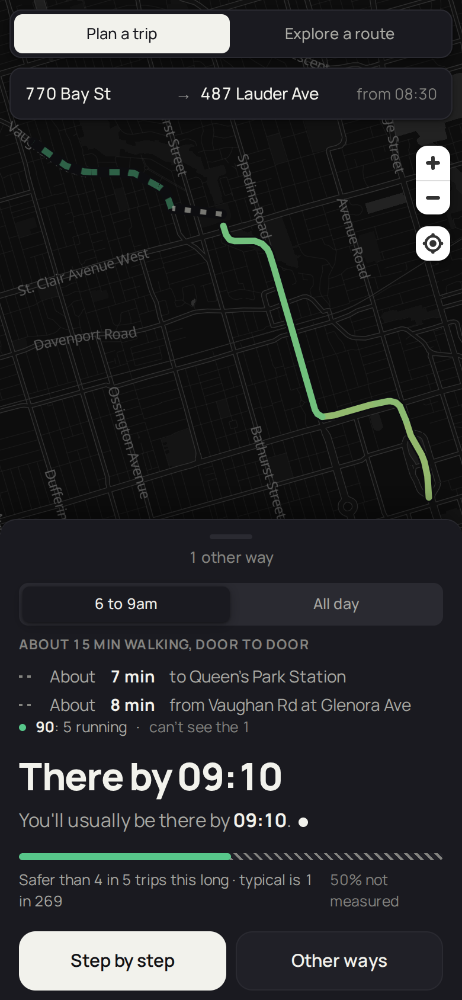
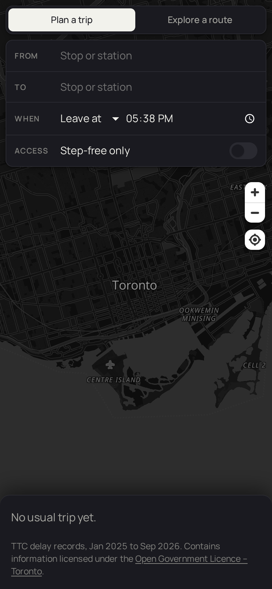

# Reliable Transit — Toronto

A reliability-aware view of the TTC: not "how fast is this route" but **"how likely is it
to actually work, and where does it break."**

<p align="center">
  
  &nbsp;
  
</p>

A map-first TTC trip planner. Type a street address or a stop, and it plans the trip
door to door, then says how often that trip actually goes wrong, where, and what it costs
you when it does, from 21 months of the TTC's own delay records. Where the data is too thin
to say, it says that instead of guessing.

The full story, including the findings that reversed decisions: the
[case study](docs/portfolio/CASE-STUDY.md).

## The premise

Transit unreliability is not random. Ranking TTC stations by delay independently across
2025 and 2026 gives a Spearman correlation of **0.78** — bad places stay bad. That makes
unreliability predictable, and therefore routable.

Two findings shape the product:

- **The rider's wait is not the vehicle's delay.** Median bus headway gap during an
  incident is 26 minutes against 13 minutes of vehicle lateness; **83.8% of bus incidents
  carry the bunching signature.** Every public tool reports the smaller number.
- **Nobody publishes reliability below the route level.** Reliability-aware TTC routing
  already exists; segment-level reliability does not. That gap is the product.

## Where the reasoning lives

Product decisions are not re-argued from opinion. `docs/ux/` holds the chain:

```
Evidence -> Problem -> Principle -> Decision -> Implementation
```

Start at [`docs/ux/README.md`](docs/ux/README.md). Every decision cites a principle,
every principle cites evidence, and every decision records what would reverse it.

## Data sources

All public, no API keys required. Last ingested 2026-11-06.

| Source | Use | Notes |
|---|---|---|
| TTC delay data (subway/bus/streetcar) | Historical reliability | 180,027 incidents, 2025-01-01 to 2026-09-30 |
| GTFS static | Network topology, geometry | 237 routes, 9,357 stops |
| GTFS-RT | Which routes are moving now | Surface only — **no subway realtime**; route level only (`D-47`) |
| Address points | Planning from a door | 525,470 municipal addresses (`D-48`) |
| Basemap | Map tiles | OpenFreeMap, OpenStreetMap data |

Contains information licensed under the
[Open Government Licence – Toronto](https://open.toronto.ca/open-data-license/).

Known limits, treated as design constraints rather than footnotes: the subway has no
realtime feed, 34% of surface delay records cannot be geocoded, and 65% of delay records
are zero-minute non-events. See `docs/ux/01-evidence.md`.

## Status

**Built.** Every milestone `M0`–`M12` ships: ingestion, the segment reliability model, the
routing engine, reliability ranking, departure advice, day-of disruptions, step-free routing,
and a mobile-first app that plans a trip and explores a route. Six audits run with
pre-registered thresholds, 182 tests pass, and the whole thing runs as one container.

What is **not** done is validation. Every persona is provisional — derived from published
research and our own delay data, never from talking to a Toronto rider — and eight
pre-registered questions are waiting on sessions that have not happened (`D-08`,
`docs/ux/08-research.md`). It has also never been deployed: the image is built and verified
locally, but `fly deploy` needs an account.

`docs/STATE.md` is the anchor and is kept current.

## Run it

Node 20 or later. TypeScript throughout: Fastify and Prisma on SQLite for the API, React
and MapLibre for the app.

```bash
npm install && (cd web && npm install)
echo 'DATABASE_URL="file:'$PWD'/data/transit.db"' > .env
npx prisma db push
npm run data              # download the open data and build everything (~6 min)
npm run dev               # API on :3000
cd web && npm run dev     # app on :5173
```

`npm test` runs the suite; `npm run build && npm start` serves the production build on
:3000. The commands for each audit are in `docs/STATE.md`.

## License

The code is MIT ([LICENSE](LICENSE)). The data belongs to its publishers, under the
licences named above.
