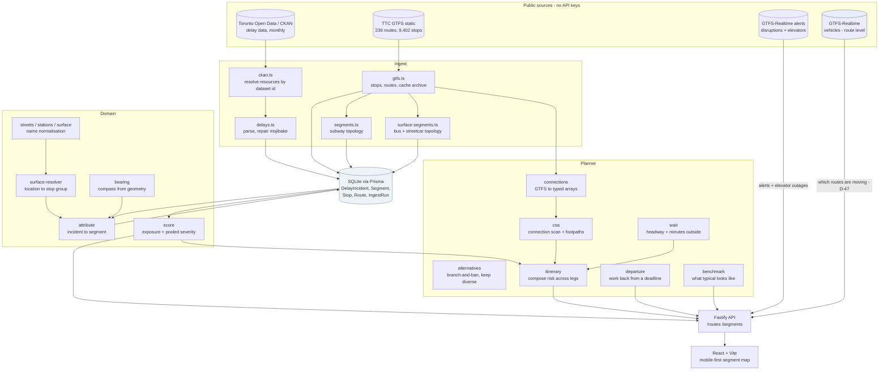
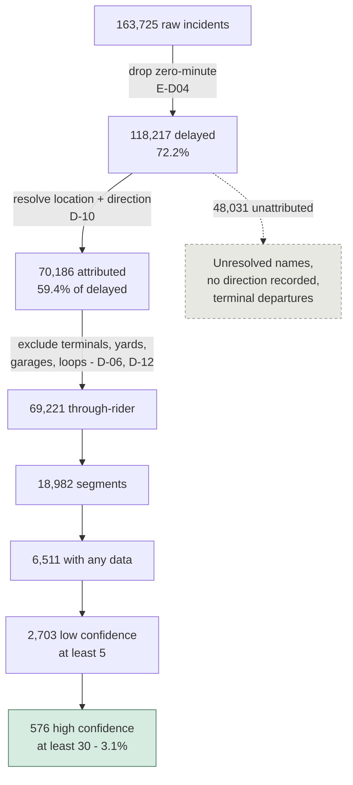
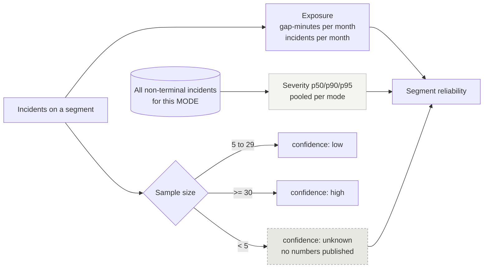

# System Architecture

What actually runs, as of **2026-09-02 — M12 plus the benchmark, route ranking, vanishing
service, D-34, and the 2026-09-02 design upgrade (D-39, D-42–D-47).** Planned components are marked; nothing here is aspirational unless
labelled. Diagrams are parsed by `npm run check:diagrams`, because GitHub renders a broken
one as nothing at all.

---

## Data flow

**Realtime is consumed at two levels, and a third is impossible.** The alerts feed qualifies
today's answer (`D-29`) and blocks step-free routing on elevator outages (`D-30`). The
vehicles feed says **which routes are moving right now** (`D-47`).

**A stop-level countdown is not available, and the reason is not effort.** Both feeds are
live and fetched, but `bustime.ttc.ca` uses a different identifier space from the static
GTFS: 1 trip id in 2,301 matches, and the stop ids collide *coincidentally* — the obvious
join returns Scarborough routes for a stop on Queen St West, silently, at over half of all
stops (`E-D29`). Route ids match 180 of 181, which is the join that holds. J-02's countdown
and J-03 are blocked on a crosswalk neither publisher provides.

Alerts carry no `active_period`, so presence in the latest snapshot is the only evidence one
is live. The app reports the snapshot's age and stops claiming to know past twelve hours —
silence would read as "nothing is wrong today".

## The filtering funnel

Every exclusion below is a recorded decision, not a convenience. This is the diagram that
explains why 163,725 records become 576 confidently-scored segments.

The funnel is the product's honesty problem in one picture. **Only 3.1% of segments reach
high confidence**, which is why `P-03` governs the interface and why Q-A is the highest
open question.

## Scoring model

**Exposure is segment-specific; severity is not.** Exposure persists across time periods
(rho 0.68), severity does not (rho 0.10 with only 3% ties). Publishing a per-segment p95
would be noise formatted as precision — `D-11`, the decision the measurements forced.

Severity pools **per mode**, never across: subway 9/17/23 minutes, surface 24/59/73.

## How a trip gets its alternatives

Connection Scan answers one question — earliest arrival — so a second opinion comes from
changing the question. `alternatives()` bans a route the best journey uses and re-plans, then
expands each survivor the same way (branch-and-ban, depth two). Six candidates are generated;
**four are returned, chosen by lowest route overlap** rather than by rank, because four
variations on one corridor is one option shown four times (`D-39`).

The funnel above explains the ceiling. **At any pool size the median trip has zero
alternatives that clear the comparison bar**, because 3.1% of segments reach high confidence
— so a wider search raises a rate that starts near one percent and cannot manufacture a
comparison from segments that were never scored (`E-D27`). Searching wider than six is
actively worse: the extra journeys are two-ban contrivances that crowd out the alternatives a
rider would consider.

Where choice *is* real, the rates are an order of magnitude higher — a materially safer
option on 12.3% of downtown trips against 1.3% citywide — which is why comparison is scoped
to `F-03` and not to the citywide list (`D-40`).

## Audits as gates

Six reproducible checks. Each can fail; together they are how claims stay falsifiable
(`P-08`).

| Command | Asks | Threshold | Result |
|---|---|---|---|
| `audit:gap` | Is `Min Gap` trustworthy? | 95% coherence + completeness | **pass** — 95.2–99.6% |
| `audit:stability` | Does segment reliability persist? | rho > 0.5 | **pass on exposure** 0.68; severity 0.10 |
| `audit:coverage` | Can we place surface delay on a map? | beat 66.1% | **pass** — 76.6% |
| `audit:timeofday` | Does pooling across the day misrepresent risk? | dispersion > 25%, rho > 0.3 | **pass** — 31.2%, rho 0.406 |
| `audit:headway` | Is "runs every N min" discriminating? | fires on 5–50% of departures | **pass** — 25.0% |
| `audit:transfers` | Does a transfer cost anything in the ranking? | blind above 90%, exposure above 10% | **pass on ranking** — 73.1%; 13.0% exposed |
| `npm test` | 171 unit tests | all pass | **pass** |

Thresholds are pre-registered **in the source**, so a verdict cannot be renegotiated after
seeing the numbers. Two of these audits reversed the design they were written to confirm:
`audit:stability` killed per-segment percentiles (`D-11`), and `audit:headway` moved the
justification for `D-34` from risk to frequency.

`npm run check:diagrams` is a seventh check of a different kind — it parses every mermaid
block in `docs/`, because GitHub fails one silently.

## What is not built

| | Needed for | Status |
|---|---|---|
| GTFS-RT stop-level arrivals | J-02 countdown, J-03 | **fetched, but unjoinable** — the feed is a different id space (`E-D29`). Route-level is built (`D-47`) |
| Walk comparison | J-05, U-05 | **built** — `WalkVsWait`, downtown only (`F-03`, `D-40`) |
| Weather signal | `PR-13` | not started |
| Shelter data at stops | `PR-13`, D-34's "outside" figure | not ingested; the app says *outside* and claims nothing about cover |
| Rider validation | `D-08` — everything | **the binding constraint.** See `08-research.md` |

`D-07`, the accessibility commitment that outran the build when this file was first written,
is closed: elevator outages are ingested from the alerts feed and `D-30` routes around
stations that are not step-free.

**Nothing on this list is blocked on more analysis of the data we hold.** Two items need a
feed we do not fetch, one needs a dataset we have not ingested, and the largest needs a
Toronto rider.

## Deployment note

Everything runs from public data with no keys. SQLite is a development choice; Prisma makes
the move to Postgres mechanical when segment aggregation outgrows it (`D-09`).
